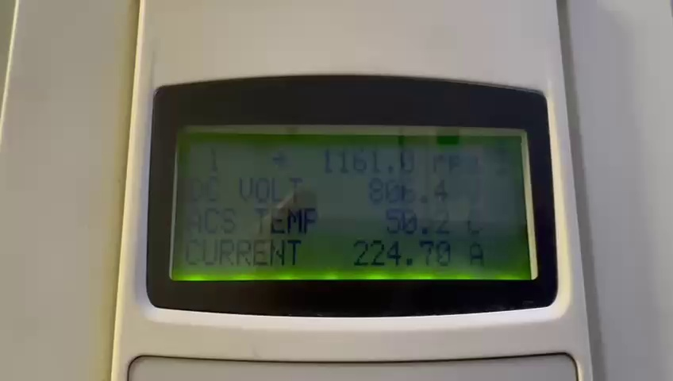

# LCD Video DataLogger 📹→📊

> **Automatically extract voltage & current readings from any LCD display recorded on video — no manual transcription needed.**

A PyTorch-based computer vision pipeline that:
1. **Detects** the LCD panel in every video frame (handles handheld/shaky footage).
2. **Reads** the digits with a custom-trained CNN — not generic OCR — so it works perfectly on dot-matrix and segmented-display fonts.
3. **Exports** a clean `frame | voltage | current | time` Excel sheet ready for analysis.
4. **Plots** publication-quality graphs with optional cluster reference lines.

---

## Demo

| Raw video frame | Detected LCD crop | Extracted data |
|---|---|---|
|  |  | `806.4 V, 224.70 A` |

*Built for a research experiment to digitise instrument readings off video — tested on a dot-matrix LCD with green backlight, recorded handheld with a smartphone at 30 fps.*

---

## Why not just use Tesseract / EasyOCR?

Generic OCR engines are trained on printed fonts, not the unique 7-segment / dot-matrix fonts used on instrument displays. This tool trains a tiny CNN **on your own LCD**, so it learns the exact pixel patterns of your screen and achieves **>95 % exact-match accuracy** on unseen frames.

---

## Quickstart

### 1 — Install dependencies

```bash
pip install -r requirements.txt
```

For GPU acceleration (recommended, ~10× faster training):
```bash
pip install torch torchvision --index-url https://download.pytorch.org/whl/cu121
```

### 2 — Tune the LCD detector colour (one time per setup)

```bash
python tune_hsv.py --video your_video.mp4
```

Drag the trackbars until the LCD border shows up **white** in the mask panel.  
Press **S** to save the values to `hsv_config.txt`.

### 3 — Label ~100 frames manually

```bash
python label.py --video your_video.mp4 --output labels.xlsx \
    --hsv_lower 40 50 50 --hsv_upper 90 255 255
```

A popup dialog shows the cropped LCD. Type `voltage,current` (e.g. `806.4,224.70`) and click OK. Skip unchanged frames with a blank entry. Aim for **50–200 labels** covering the full value range — you can stop and resume any time.

### 4 — Train the model

```bash
python train.py --video your_video.mp4 --excel labels.xlsx \
    --hsv_lower 40 50 50 --hsv_upper 90 255 255
```

Training takes ~5 minutes on a GPU, ~30 minutes on CPU. The best weights are saved to `lcd_ocr_model.pth`.

### 5 — Extract all data

```bash
python extract.py --video your_video.mp4 --output readings.xlsx \
    --vol_min 600 --vol_max 1300 --cur_min 100 --cur_max 600
```

The `--vol_min/max` and `--cur_min/max` bounds filter out OCR noise. Any out-of-range reading is replaced by the last valid value (forward-fill). Resume after interruption by simply re-running the same command — it picks up from the last saved frame.

### 6 — Plot

```bash
# Single file
python plot.py --inputs readings.xlsx --vol_min 600 --vol_max 1300

# Two files compared with cluster reference lines
python plot.py --inputs run1.xlsx run2.xlsx \
    --labels "Run 1" "Run 2" \
    --vol_min 600 --vol_max 1300 \
    --cur_min 100 --cur_max 600 \
    --vol_clusters 818 1078 \
    --cur_clusters 241 454
```

---

## File overview

```
lcd-video-datalogger/
├── model.py          # MultiDigitNet architecture + encode/decode helpers
├── lcd_detector.py   # HSV-based LCD panel locator
├── label.py          # Interactive manual labelling tool
├── train.py          # Model training script
├── extract.py        # Full-video extraction script
├── plot.py           # Graph generation
├── tune_hsv.py       # Interactive HSV colour tuner
├── requirements.txt
└── docs/             # Images for this README
```

---

## Adapting to your LCD

| What to change | Where |
|---|---|
| LCD border colour | `--hsv_lower` / `--hsv_upper` (use `tune_hsv.py`) |
| Number of decimal places | Modify `encode_label()` / `decode_prediction()` in `model.py` |
| Number of digits displayed | Change `range(10)` in `MultiDigitNet` to the total character count |
| Input resolution | `output_size` in `LCDDetector` (default `128×64`) |
| Detection method | Subclass `LCDDetector` and override `detect()` — e.g. use feature matching for non-coloured borders |

---

## How it works

```
Video frame
    │
    ▼
LCDDetector.detect()          ← HSV colour threshold → largest contour → crop + resize
    │
    ▼
MultiDigitNet (ResNet-18 backbone)
    │  10 independent heads, each predicts one character (0-9 or blank)
    ▼
decode_prediction()           ← reconstruct float values from digit sequence
    │
    ▼
Validity bounds check         ← reject physically impossible readings
    │
    ▼
Forward-fill                  ← propagate last valid reading over bad frames
    │
    ▼
Excel / plot output
```

### Model architecture

```
Input: 128×64 RGB patch
  └─ ResNet-18 (pretrained ImageNet weights, fine-tuned)
       └─ 512-d feature vector
            ├─ Linear(512, 11) → digit 0  (voltage hundreds)
            ├─ Linear(512, 11) → digit 1  (voltage tens)
            ├─ Linear(512, 11) → digit 2  (voltage ones)
            ├─ Linear(512, 11) → digit 3  (voltage 1st decimal)
            ├─ Linear(512, 11) → digit 4  (voltage 2nd decimal)
            ├─ Linear(512, 11) → digit 5  (current hundreds)
            ├─ Linear(512, 11) → digit 6  (current tens)
            ├─ Linear(512, 11) → digit 7  (current ones)
            ├─ Linear(512, 11) → digit 8  (current 1st decimal)
            └─ Linear(512, 11) → digit 9  (current 2nd decimal)

Class 10 = blank / leading-zero padding
```

---

## Tips for best accuracy

- **Lighting consistency:** consistent room lighting helps HSV detection; if the video was taken in different lighting conditions, increase data augmentation (`ColorJitter`) in `train.py`.
- **More labels = better model:** if accuracy is below 90 %, add another 50 diverse labels and retrain.
- **Frame step:** the default `--frame_step 5` processes every 5th frame (6 fps equivalent). Lower it to `1` if values change very rapidly.
- **GPU:** any CUDA-capable GPU (even GTX 1060) will train in under 5 minutes.

---

## Output format

`extract.py` writes an Excel file with these columns:

| column | type | description |
|---|---|---|
| `frame` | int | 0-based video frame index |
| `voltage` | float | Voltage reading in the unit displayed |
| `current` | float | Current reading in the unit displayed |
| `time` | float | Timestamp in seconds (`frame / fps`) |

---

## Requirements

- Python ≥ 3.10
- PyTorch ≥ 2.0 (CPU or CUDA)
- OpenCV, pandas, openpyxl, matplotlib

See `requirements.txt` for pinned versions.

---

## License

MIT — free to use, modify, and distribute. A star ⭐ is appreciated if this saves you hours of manual work!

---

## Acknowledgements

Built to automate data extraction for a research experiment, replacing hours of manual transcription from video footage. The training workflow is inspired by the idea that **a tiny model trained on your own data beats a huge generic model every time**.
